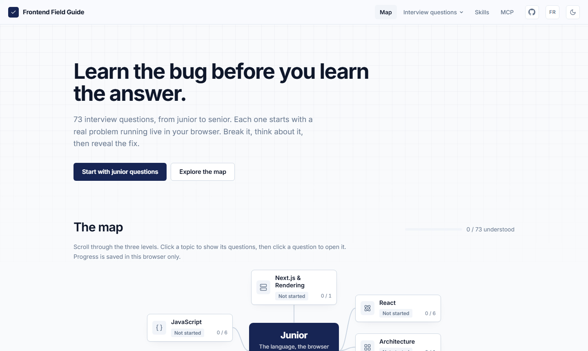
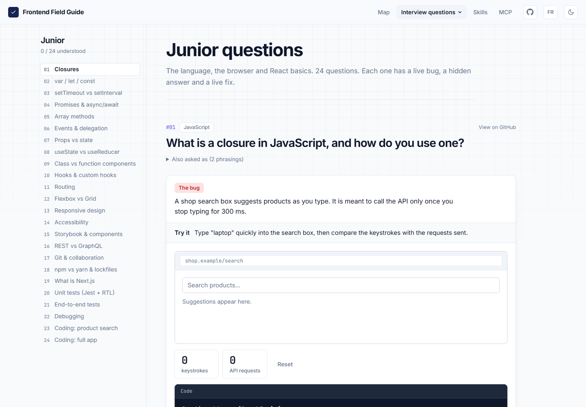
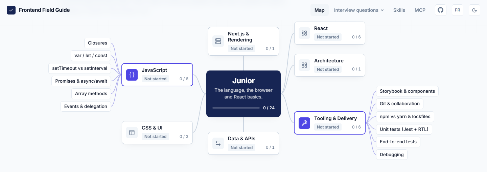

<div align="center">


# Frontend Field Guide

**افهم الخطأ البرمجي قبل أن تحفظ الإجابة.**

73 سؤال مقابلة لمطوري واجهات المستخدم (Frontend)، من المستوى المبتدئ إلى الخبير.
يبدأ كل سؤال بخطأ برمجي حقيقي يعمل مباشرة في متصفحك. تكتشف الخلل بنفسك، تفكّر في أسبابه، ثم تستعرض الحل الصحيح.

[**افتح الموقع**](https://frontend-roadmap-website.vercel.app/?lang=ar) · [الأسئلة بصيغة Markdown](content/README.md) · [المساهمة](CONTRIBUTING.md) · [English version](README.md) · [Version française](README.fr.md)

[](https://github.com/ahmedgourmat/Frontend-roadmap/actions/workflows/ci.yml)
[](LICENSE)
[](content/LICENSE)
[](#اللغات-المدعومة)
[](CONTRIBUTING.md)

</div>



## لماذا هذا المشروع

تعطيك معظم قوائم أسئلة المقابلات سؤالاً وفقرة نصية لحفظها عن ظهر قلب. لكن في المقابلة الحقيقية، ستواجه أسئلة متابعة وتعمق: *لماذا يحدث ذلك تحديداً؟ ما الذي قد يتعطل في بيئة الإنتاج؟ وما الذي ستفعله أنت بدلاً من ذلك؟*

هنا، تم بناء كل سؤال حول خطأ برمجي فعلي من بيئة الإنتاج:

1. **الخطأ البرمجي، حي ومباشر.** تطبيق مصغر يشغّل الكود الذي به خلل. توضح لك المهمة ما يجب تجربته لترى الخطأ يحدث أمامك.
2. **المفهوم الأساسي.** الإجابة الموجزة التي يتوقع المحاور سماعها.
3. **الحل، حي ومباشر.** نفس التطبيق مع الكود المصحح، لترى الفارق بوضوح.
4. **كيف تصيغ إجابتك.** الجملة المفتاحية، والمصائد الشائعة، والموازنات التي ينبغي ذكرها.



## المميزات

- **73 سؤالاً** موزعة على ثلاثة مستويات: 24 للمبتدئ (Junior)، و 26 للمتوسط (Mid-level)، و 23 للخبير (Senior). تم استخلاصها ودمجها من حوالي 130 سؤالاً من عدة مصادر، بحيث يظهر كل مفهوم مرة واحدة دون تكرار.
- **عرض تفاعلي مباشر لكل سؤال**، مع إمكانية مقارنة الخطأ البرمجي والحل جنباً إلى جنب.
- **خارطة طريق تعليمية** تجمع الأسئلة حسب المستوى والموضوع (JavaScript، React، CSS، الأداء، الأمان، المعمارية الهندسية، والمزيد). يُحفظ تقدمك في متصفحك دون الحاجة لإنشاء حساب.
- **متعدد اللغات (الإنجليزية، الفرنسية، العربية).** كل سؤال وإجابة وصفحة مترجمة بدقة واحترافية.
- **أدلة إضافية**: مهارات الوكلاء (Agent skills) وخوادم MCP الأكثر فائدة لعمل مطوري الواجهات الأمامية.
- **المظهر الداكن والفاتح**، والتنقل السلس عبر لوحة المفاتيح، وتصميم متجاوب بالكامل مع الهواتف المحمولة.



## تشغيل المشروع محلياً

يتطلب المشروع Node.js بإصدار 20.19 أو أحدث (تستخدم بيئة CI الإصدار المحدد في [`.nvmrc`](.nvmrc)).‏

```bash
git clone https://github.com/ahmedgourmat/Frontend-roadmap.git
cd Frontend-roadmap/site
npm install
npm run dev        # http://localhost:5173
```

| الأمر | الوظيفة |
| --- | --- |
| `npm run dev` | تشغيل خادم التطوير مع التحديث التلقائي السريع (Hot reload) |
| `npm run build` | فحص الأنواع وبناء الموقع الثابت داخل مجلد `site/dist` |
| `npm run preview` | استعراض ومراجعة نسخة الإنتاج محلياً |
| `npm run check` | تشغيل جميع الفحوصات أدناه، تماماً كما تفعل أنظمة CI عند فتح طلب سحب (PR) |
| `npm run check:content` | فحص كل سؤال: الأقسام الأربعة `##`، سطر `catalog.ts`، العرض التفاعلي، وملفات الترجمة |
| `npm run typecheck` | تشغيل فحص TypeScript فقط |
| `npm run lint` | تشغيل فحص ESLint |
| `npm run format` | تنسيق الأكواد باستخدام Prettier (`npm run format:check` للفحص فقط) |
| `npm test` | تشغيل الاختبارات لمرة واحدة عبر Vitest (`npm run test:watch` للتشغيل المستمر) |
| `npm run titles` | إعادة إنشاء `src/generated/titles.json` (يعمل تلقائياً قبل `dev` و `build`) |

## هيكلية المشروع

```
.
├── content/                  الأسئلة، ملف markdown مستقل لكل سؤال (المصدر المرجعي الموحد)
│   ├── junior/ mid/ senior/  النسخة الإنجليزية
│   ├── fr/                   النسخة الفرنسية، بنفس أسماء الملفات
│   ├── ar/                   النسخة العربية، بنفس أسماء الملفات
│   └── README.md             فهرس لجميع الأسئلة والتكرارات المدمجة
└── site/                     الموقع الإلكتروني (Vite + React + TypeScript)
    ├── scripts/              أدوات مساعدة للبناء (عناوين الأسئلة للخارطة، فحص المحتوى)
    └── src/
        ├── catalog.ts        المستويات، والمواضيع، والوسم القصير لكل سؤال
        ├── content.ts        تحميل وتحليل ملفات markdown
        ├── demos/            عرض تفاعلي مباشر لكل سؤال: demos/<level>/<slug>.tsx
        ├── demo-kit/         مكونات مشتركة للعروض (إطار المتصفح، وحدة التحكم، الأزرار…)
        ├── i18n/             نصوص الواجهة بالإنجليزية، والفرنسية، والعربية
        ├── components/       الخارطة، صفحة الأسئلة، معالج markdown
        ├── pages/            الصفحة الرئيسية، صفحات المستويات، صفحات المهارات و MCP
        └── styles/
```

## اللغات المدعومة

يحدد الموقع اللغة بناءً على الرابط `?lang=ar` أولاً، ثم خيارك الأخير المحفوظ، ثم لغة المتصفح. يمكنك التبديل بين اللغات في أي وقت من زر اللغة في شريط التنقل.

- الأسئلة: `content/<level>/<slug>.md` (الإنجليزية)، `content/fr/<level>/<slug>.md` (الفرنسية)، و `content/ar/<level>/<slug>.md` (العربية).‏
- نصوص الواجهة: `site/src/i18n/en.ts`، `site/src/i18n/fr.ts`، و `site/src/i18n/ar.ts`.‏
- تعليمات العروض التفاعلية: `site/src/demos/fr.ts` و `site/src/demos/ar.ts`. تبقى النصوص داخل التطبيقات المصغرة بالعروض التفاعلية باللغة الإنجليزية لتطابق الكود الفعلي.

إذا كان أي ملف باللغة العربية غير متوفر، يعرض الموقع النسخة الإنجليزية مع تنبيه بذلك. نرحب دائماً بالمساهمة في الترجمات أو إضافة لغات جديدة.

## المساهمة

هل وجدت إجابة بحاجة لتصحيح، أو صياغة أوضح لتفسير مفهوم معين، أو سؤالاً مهماً غير موجود، أو ترغب في تحسين ترجمة؟ نرحب بجميع المساهمات، مهما كان حجمها!

- [الإبلاغ عن خطأ في إجابة](https://github.com/ahmedgourmat/Frontend-roadmap/issues/new?template=content-error.yml)
- [اقتراح سؤال جديد](https://github.com/ahmedgourmat/Frontend-roadmap/issues/new?template=new-question.yml)
- [قراءة دليل المساهمة](CONTRIBUTING.md) (باللغة الإنجليزية): كيفية إضافة سؤال أو عرض تفاعلي أو ترجمة

يرجى الالتزام بـ [ميثاق قواعد السلوك](CODE_OF_CONDUCT.md).‏

يمكنك كتابة المشاكل (Issues) وطلبات السحب (Pull Requests) باللغة العربية.

## النشر

المجلد `site/dist` يمثل تطبيق صفحة واحدة ثابت (SPA). يقوم كل من `site/vercel.json` (لدى Vercel) و `site/public/_redirects` (لدى Netlify) بتوجيه جميع المسارات إلى `index.html`، بحيث تعمل روابط مثل `/mid#07-array-index-as-key` بنجاح عند تحديث الصفحة.

عند النشر على Vercel أو Netlify، حدد المجلد الرئيسي كـ `site`، وأمر البناء كـ `npm run build`، ومجلد الإخراج كـ `dist`.‏

## الترخيص

- الكود البرمجي للموقع (`site/`): رخصة [MIT](LICENSE).‏
- الأسئلة والإجابات (`content/`): رخصة المشاع الإبداعي [CC BY 4.0](content/LICENSE). يمكنك إعادة استخدامها وتكييفها، بما في ذلك للأغراض التجارية، بشرط الإشارة إلى هذا المشروع ونسب الفضل إليه.
