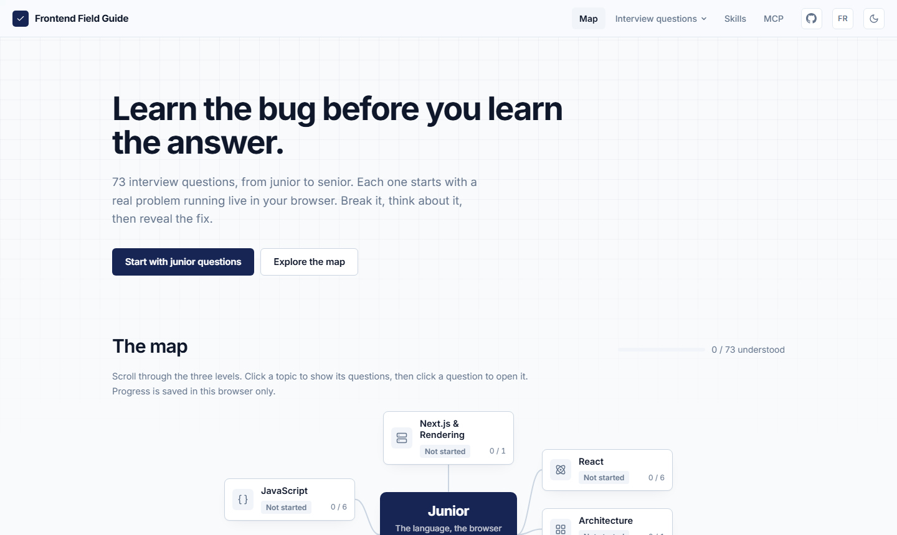

<div align="center">


# Frontend Field Guide

**Comprenez le bug avant d’apprendre la réponse.**

73 questions d’entretien frontend, du niveau junior au niveau senior.
Chacune commence par un vrai bug qui tourne en direct dans votre navigateur. Vous le provoquez, vous réfléchissez, puis vous affichez la correction.

[**Ouvrir le site**](https://frontend-roadmap-website.vercel.app/?lang=fr) · [Les questions en markdown](content/README.md) · [Contribuer](CONTRIBUTING.md) · [English version](README.md)

</div>



## Pourquoi ce projet

La plupart des listes de questions d’entretien donnent une question et un paragraphe à apprendre par cœur. En entretien, il y a toujours des relances : *pourquoi ça arrive ? qu’est-ce qui casse en production ? que feriez-vous à la place ?*

Ici, chaque question est construite autour d’un bug de production :

1. **Le bug, en direct.** Une petite application exécute le code fautif. Une consigne vous dit quoi essayer pour le voir échouer.
2. **Le concept.** La réponse courte attendue par le recruteur.
3. **La correction, en direct.** La même application, corrigée, pour voir la différence.
4. **Comment le dire.** La phrase clé, les pièges et les compromis à mentionner.

## Fonctionnalités

- **73 questions** sur trois niveaux : 24 junior, 26 intermédiaire, 23 senior. Elles regroupent environ 130 questions issues de plusieurs listes d’entretien, pour que chaque notion n’apparaisse qu’une fois.
- **Une démo en direct pour chaque question**, avec le bug et sa correction.
- **Une carte d’apprentissage** qui range les questions par niveau et par thème. La progression est enregistrée dans votre navigateur, sans compte.
- **Anglais et français.** Chaque question, réponse et page est traduite. Le texte à l’intérieur des démos reste en anglais.
- **Guides en plus** : les skills d’agent et les serveurs MCP utiles pour le frontend.
- **Thème clair et sombre**, navigation au clavier et mise en page adaptée au mobile.

## Lancer le projet

Il faut Node.js 20.19 ou plus récent.

```bash
git clone https://github.com/ahmedgourmat/Frontend-roadmap.git
cd Frontend-roadmap/site
npm install
npm run dev        # http://localhost:5173
```

`npm run check` lance toutes les vérifications (contenu, types, lint, formatage, tests), comme la CI. `npm run build` génère le site statique dans `site/dist`.

## Contribuer

Une réponse fausse, une explication plus claire, une question qui manque, une traduction à améliorer ? Toutes les contributions sont les bienvenues, même petites.

- [Signaler une erreur dans une réponse](https://github.com/ahmedgourmat/Frontend-roadmap/issues/new?template=content-error.yml)
- [Proposer une question](https://github.com/ahmedgourmat/Frontend-roadmap/issues/new?template=new-question.yml)
- [Améliorer une traduction](https://github.com/ahmedgourmat/Frontend-roadmap/issues/new?template=translation.yml)
- [Lire le guide de contribution](CONTRIBUTING.md) (en anglais)

Les issues et pull requests peuvent être écrites en français.

## Licence

- Code (`site/`) : [MIT](LICENSE).
- Questions et réponses (`content/`) : [CC BY 4.0](content/LICENSE). Vous pouvez les réutiliser et les adapter, y compris à des fins commerciales, en citant ce projet.
