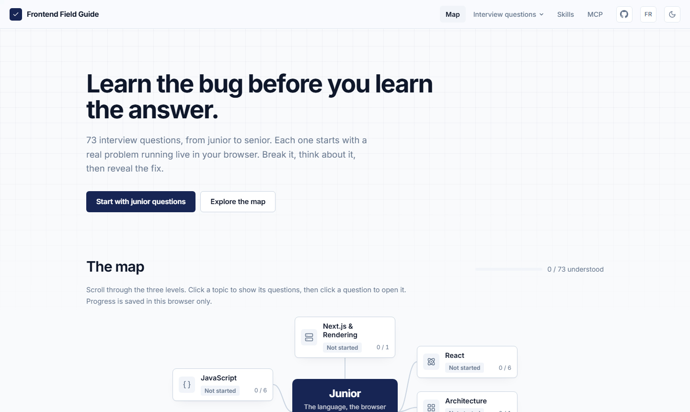
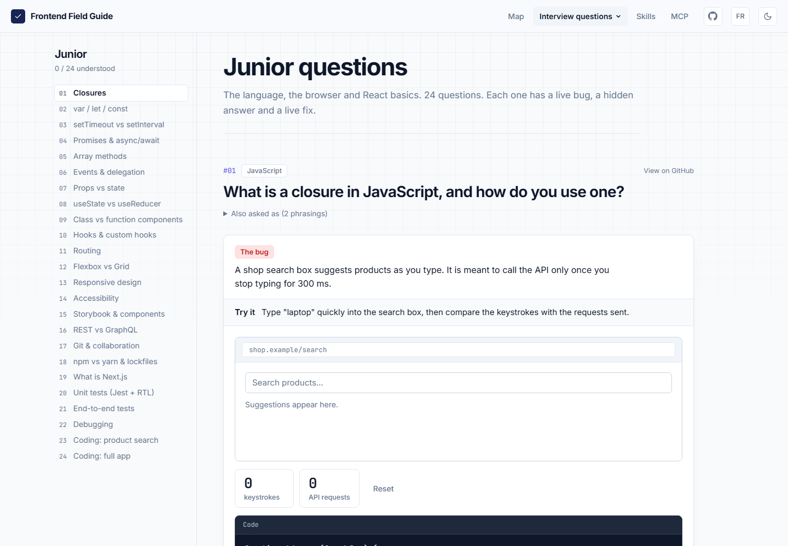
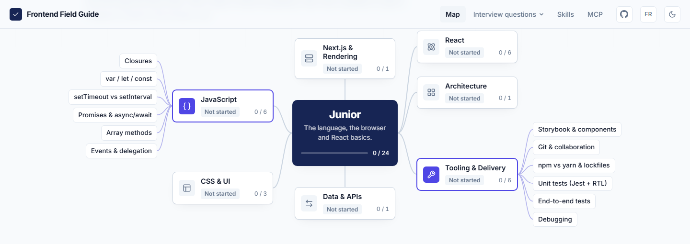

<div align="center">


# Frontend Field Guide

**Learn the bug before you learn the answer.**

73 frontend interview questions, from junior to senior.
Each one starts with a real bug running live in your browser. You break it, think about it, then reveal the fix.

[**Open the site**](https://frontend-roadmap-website.vercel.app) · [Questions as markdown](content/README.md) · [Contribute](CONTRIBUTING.md) · [Version française](README.fr.md)

[](https://github.com/ahmedgourmat/Frontend-roadmap/actions/workflows/ci.yml)
[](LICENSE)
[](content/LICENSE)
[](#languages)
[](CONTRIBUTING.md)

</div>



## Why this exists

Most interview lists give you a question and a paragraph to memorise. In a real interview you get follow-ups: *why does that happen? what breaks in production? what would you do instead?*

Here, every question is built around one production bug:

1. **The bug, live.** A small app runs the broken code. A task tells you what to try so you see it fail.
2. **The concept.** The short answer the interviewer expects.
3. **The fix, live.** The same app, fixed, so the difference is obvious.
4. **How to say it.** The key sentence, the traps and the trade-offs to mention.



## Features

- **73 questions** in three levels: 24 junior, 26 mid-level, 23 senior. They were merged from about 130 questions found in several interview lists, so each concept appears once.
- **A live demo for every question**, with the bug and the fix side by side.
- **A learning map** that groups the questions by level and topic (JavaScript, React, CSS, performance, security, architecture and more). Progress is saved in your browser, with no account.
- **English and French.** Every question, answer and page is translated.
- **Extra guides**: agent skills and MCP servers that are useful for frontend work.
- **Light and dark themes**, keyboard navigation and a layout that works on phones.



## Run it locally

You need Node.js 20.19 or newer (CI uses the version in [`.nvmrc`](.nvmrc)).

```bash
git clone https://github.com/ahmedgourmat/Frontend-roadmap.git
cd Frontend-roadmap/site
npm install
npm run dev        # http://localhost:5173
```

| Command | What it does |
| --- | --- |
| `npm run dev` | Starts the dev server with hot reload |
| `npm run build` | Type-checks and builds the static site into `site/dist` |
| `npm run preview` | Serves the production build |
| `npm run check` | Runs every check below, like CI does on a pull request |
| `npm run check:content` | Checks every question: the four `##` sections, its `catalog.ts` line, its demo and its French files |
| `npm run typecheck` | Runs TypeScript only |
| `npm run lint` | Runs ESLint |
| `npm run format` | Formats the code with Prettier (`npm run format:check` only checks) |
| `npm test` | Runs the tests once with Vitest (`npm run test:watch` keeps them running) |
| `npm run titles` | Regenerates `src/generated/titles.json` (runs automatically before `dev` and `build`) |

## Project layout

```
.
├── content/                  the questions, one markdown file each (the single source of truth)
│   ├── junior/ mid/ senior/  English
│   ├── fr/                   French, same file names
│   └── README.md             index of every question and the duplicates it merges
└── site/                     the website (Vite + React + TypeScript)
    ├── scripts/              build helpers (question titles for the map, content check)
    └── src/
        ├── catalog.ts        levels, topics and the short label of every question
        ├── content.ts        loads and parses the markdown files
        ├── demos/            one live demo per question: demos/<level>/<slug>.tsx
        ├── demo-kit/         shared building blocks for demos (browser frame, console, buttons…)
        ├── i18n/             interface text in English and French
        ├── components/       map, question page, markdown renderer
        ├── pages/            home, level, skills and MCP pages
        └── styles/
```

## Languages

The site picks the language from `?lang=fr`, then your last choice, then your browser. You can switch at any time with the **EN / FR** button.

- Questions: `content/<level>/<slug>.md` (English) and `content/fr/<level>/<slug>.md` (French).
- Interface text: `site/src/i18n/en.ts` and `site/src/i18n/fr.ts`.
- Demo instructions: `site/src/demos/fr.ts`. The text inside the demo apps stays in English.

If a French file is missing, the site shows the English version with a notice. Help with translations, or a new language, is welcome.

## Contributing

Found a wrong answer, a clearer way to explain something, or a question that is missing? Contributions are welcome, including small ones.

- [Report an error in an answer](https://github.com/ahmedgourmat/Frontend-roadmap/issues/new?template=content-error.yml)
- [Suggest a question](https://github.com/ahmedgourmat/Frontend-roadmap/issues/new?template=new-question.yml)
- [Read the contributing guide](CONTRIBUTING.md): how to add a question, a demo or a translation

Please follow the [code of conduct](CODE_OF_CONDUCT.md).

## Deploy

`site/dist` is a static single-page app. `site/vercel.json` (Vercel) and `site/public/_redirects` (Netlify) send every route to `index.html`, so links like `/mid#07-array-index-as-key` work on refresh.

On Vercel or Netlify, set the root directory to `site`, the build command to `npm run build` and the output directory to `dist`.

## License

- Code (`site/`): [MIT](LICENSE).
- Questions and answers (`content/`): [CC BY 4.0](content/LICENSE). You can reuse and adapt them, including commercially, as long as you credit this project.
